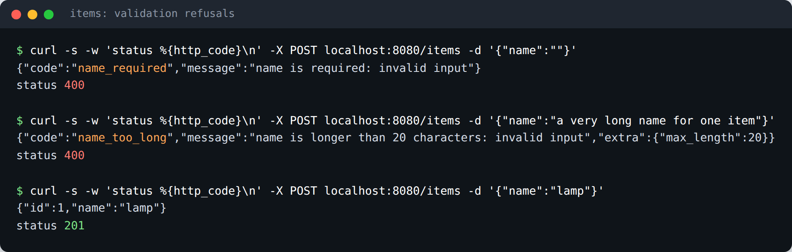
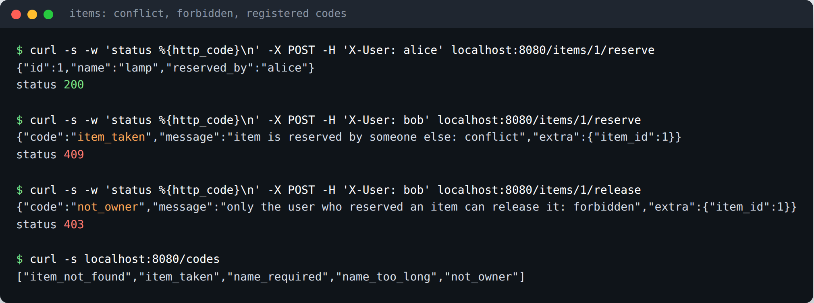
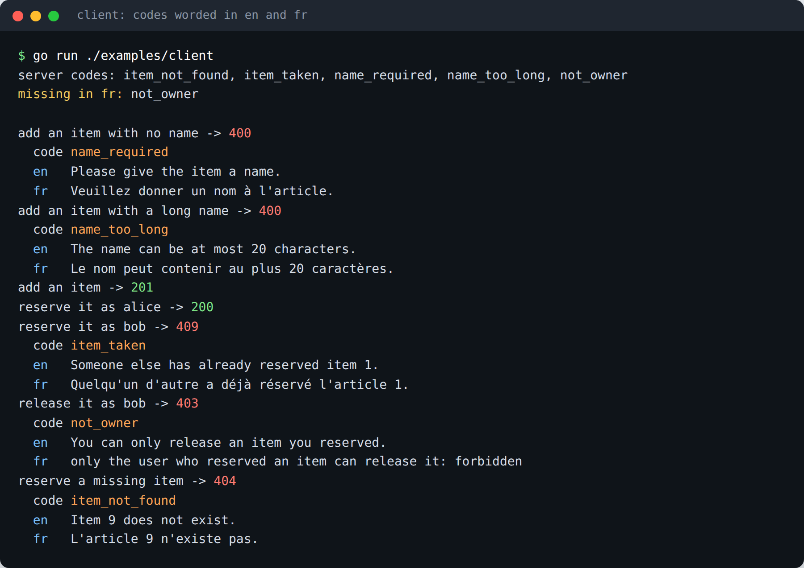

# apperr

[](https://pkg.go.dev/github.com/ez-technologies/apperr)
[](LICENSE)

Coded errors for Go applications. The layer that refuses a request (a
validator, a repository, a transaction deep in the stack) returns an error with
a **stable code**, a message, an optional cause and extra fields. The handler
reads them back from anywhere in the error chain and answers with the right
status. The client words the code in the reader's language.

The package itself uses only the standard library. It works with `errors.Is`,
`errors.As` and `fmt.Errorf("...: %w", err)`.

## Why codes

A server that answers `{"error": "name is longer than 20 characters"}` has
decided the wording for every client, in one language. Changing a comma needs
a server release, and a client that wants to react to *this* refusal has to
match on the sentence.

A server that answers with a code puts each decision where it belongs:

| Who | Decides |
| --- | --- |
| The layer that refuses | **what** went wrong: a code such as `name_too_long`, plus facts such as `max_length: 20` |
| The handler | **how** to answer: the HTTP status, and what to hide |
| The client | **how to say it**: a sentence per code, per language, with the facts filled in |

The server's own text still travels next to the code, so a client that does
not know a new code yet can show something instead of nothing.

## Install

```sh
go get github.com/ez-technologies/apperr
```

Requires Go 1.26 or later.

## Quick start

```go
package main

import (
	"errors"
	"fmt"

	"github.com/ez-technologies/apperr"
)

const CodeItemTaken apperr.Code = "item_taken"

func init() { apperr.Register(CodeItemTaken) }

func reserve(id int) error {
	return apperr.Wrap(CodeItemTaken, apperr.ErrConflict).With("item_id", id)
}

func main() {
	err := fmt.Errorf("reserving: %w", reserve(7))

	fmt.Println(errors.Is(err, apperr.ErrConflict)) // true
	fmt.Println(apperr.CodeOf(err))                 // item_taken
	fmt.Println(apperr.ExtraOf(err))                // map[item_id:7]
}
```

## Screenshots

These are real runs of the two programs in [`examples/`](examples): a small
item store over `net/http` ([`examples/httpserver`](examples/httpserver/main.go))
and a client that words its refusals in English and French
([`examples/client`](examples/client/main.go)).

**The server refuses bad input with a code, its own text and the facts the
client needs.** An empty name answers 400 with `name_required`; a long one
answers 400 with `name_too_long` and `max_length`, so the client can say what
the limit is.



**The same handler gives each kind of refusal its own status.** A second user
reserving a taken item gets 409 `item_taken`; releasing someone else's
reservation gets 403 `not_owner`. `GET /codes` lists every code the server can
answer with, from `apperr.Codes()`.



**The client words each code in two languages.** It first compares the server's
codes with its translations and reports that French has no sentence for
`not_owner`; when that refusal comes, the French line falls back to the
server's text while the English one is translated.



Run them yourself:

```sh
go run ./examples/httpserver &      # listens on localhost:8080
go run ./examples/client
curl -s -X POST localhost:8080/items -d '{"name":""}'
```

## How to

### Declare and register codes

A code is a `string` type. Declare your application's codes as constants, in
one place, and register them so they can be listed later. Treat them as part
of your API: once a client words a code, do not rename it.

```go
const (
	CodeNameRequired apperr.Code = "name_required"
	CodeNameTooLong  apperr.Code = "name_too_long"
	CodeItemNotFound apperr.Code = "item_not_found"
	CodeItemTaken    apperr.Code = "item_taken"
)

func init() {
	apperr.Register(CodeNameRequired, CodeNameTooLong, CodeItemNotFound, CodeItemTaken)
}
```

Registering is safe from several goroutines, and registering a code twice has
no effect. Registration only feeds `Codes()`; an unregistered code still works
in an error.

### Make a refusal with a code

`New` makes an error from a code and a message, with no cause:

```go
return apperr.New(CodeItemNotFound, "no item with that id")
```

### Wrap a cause

`Wrap` gives an existing error a code. The message is the cause's text, and
the cause stays in the chain, so `errors.Is` still finds it. Wrapping one of
the package's sentinels says what kind of refusal it is:

```go
// message: "name is required: invalid input"
return apperr.Wrap(CodeNameRequired, fmt.Errorf("name is required: %w", apperr.ErrInvalidInput))

// a driver or library error, now with a code your client understands
if err := tx.Commit(); err != nil {
	return apperr.Wrap(CodeItemTaken, err)
}
```

The sentinels:

| Sentinel | Means | Usual status |
| --- | --- | --- |
| `apperr.ErrInvalidInput` | the values the client sent are not acceptable | 400 |
| `apperr.ErrConflict` | the data changed underneath the caller; reload, do not fix the input | 409 |
| `apperr.ErrForbidden` | the caller may not do this | 403 |

### Attach extra fields

`With` adds a field the answer carries next to the code: the facts a client
needs to word the refusal. It returns the same error, so calls chain:

```go
return apperr.Wrap(CodeNameTooLong, fmt.Errorf("name is longer than %d characters: %w", max, apperr.ErrInvalidInput)).
	With("max_length", max).
	With("length", len(name))
```

`With` changes the error it is called on. Build a fresh error per refusal
rather than adding fields to a shared package-level one.

### Read the code and fields from any wrapped error

`CodeOf` and `ExtraOf` look through the whole chain with `errors.As`, so they
work however many times the error was wrapped on its way up. An error without
a code gives `""` and `nil`:

```go
err := fmt.Errorf("handler: %w", fmt.Errorf("service: %w", repoErr))

apperr.CodeOf(err)  // name_too_long
apperr.ExtraOf(err) // map[length:29 max_length:20]

apperr.CodeOf(errors.New("plain")) // ""
```

To reach the message or cause of the coded error itself, use `errors.As`:

```go
var coded *apperr.Error
if errors.As(err, &coded) {
	fmt.Println(coded.Code, coded.Message, coded.Cause, coded.Extra)
}
```

### Map codes to HTTP statuses in your handler

The lower layers never see HTTP; the handler decides the status. Matching on
the sentinel an error wraps covers most codes without listing them, and a code
that needs its own status is matched by name. From
[`examples/httpserver`](examples/httpserver/main.go):

```go
func statusOf(err error) int {
	switch {
	case errors.Is(err, apperr.ErrInvalidInput):
		return http.StatusBadRequest
	case errors.Is(err, apperr.ErrConflict):
		return http.StatusConflict
	case errors.Is(err, apperr.ErrForbidden):
		return http.StatusForbidden
	}
	switch apperr.CodeOf(err) {
	case CodeItemNotFound:
		return http.StatusNotFound
	}
	return http.StatusInternalServerError
}

func writeError(w http.ResponseWriter, err error) {
	status := statusOf(err)
	body := errorBody{Code: apperr.CodeOf(err), Message: err.Error(), Extra: apperr.ExtraOf(err)}
	var coded *apperr.Error
	if errors.As(err, &coded) {
		body.Message = coded.Message // not the context the handler added
	}
	if status == http.StatusInternalServerError {
		log.Printf("internal error: %v", err)
		body = errorBody{Message: "internal error"} // do not leak details
	}
	writeJSON(w, status, body)
}
```

A resource the caller may not even see is better answered as not found than
as forbidden, so its existence is not confirmed.

### Translate codes in the client

The client keeps a sentence per code per language, fills placeholders from the
extra fields, and falls back to the server's text for a code it does not know.
From [`examples/client`](examples/client/main.go):

```go
var translations = map[string]map[string]string{
	"en": {"name_too_long": "The name can be at most {max_length} characters."},
	"fr": {"name_too_long": "Le nom peut contenir au plus {max_length} caractères."},
}

func translate(lang string, e errorBody) string {
	text, ok := translations[lang][e.Code]
	if !ok {
		return e.Message
	}
	for k, v := range e.Extra {
		text = strings.ReplaceAll(text, "{"+k+"}", fmt.Sprint(v))
	}
	return text
}
```

The same works in any client language: a web front end keeps the codes in its
translation files next to the rest of its text.

### List registered codes

`Codes()` returns every registered code, sorted. Use it to check that every
code has a translation, for example in a test, or serve it from an endpoint
for a client to check against:

```go
func TestEveryCodeIsTranslated(t *testing.T) {
	for _, lang := range []string{"en", "fr"} {
		for _, code := range apperr.Codes() {
			if _, ok := translations[lang][code]; !ok {
				t.Errorf("%s has no translation for %q", lang, code)
			}
		}
	}
}
```

## API summary

| Name | Signature | Does |
| --- | --- | --- |
| `Code` | `type Code string` | stable, machine-readable name of a refusal |
| `Register` | `func Register(codes ...Code)` | adds codes to the list `Codes` returns; repeats are ignored |
| `Codes` | `func Codes() []string` | every registered code, sorted |
| `Error` | `type Error struct { Code Code; Message string; Cause error; Extra map[string]any }` | a refusal with a code; `Error()` is its `Message`, `Unwrap()` is its `Cause` |
| `New` | `func New(code Code, message string) *Error` | an error with a code and a message |
| `Wrap` | `func Wrap(code Code, cause error) *Error` | gives `cause` a code, keeping its text and chain |
| `(*Error).With` | `func (e *Error) With(key string, value any) *Error` | adds an extra field; returns `e` |
| `CodeOf` | `func CodeOf(err error) Code` | the code anywhere in `err`'s chain, or `""` |
| `ExtraOf` | `func ExtraOf(err error) map[string]any` | the extra fields anywhere in `err`'s chain, or `nil` |
| `ErrInvalidInput` | `var ErrInvalidInput error` | sentinel: the client's values were not acceptable |
| `ErrConflict` | `var ErrConflict error` | sentinel: the data changed underneath the caller |
| `ErrForbidden` | `var ErrForbidden error` | sentinel: the caller may not do this |

Full documentation is on
[pkg.go.dev](https://pkg.go.dev/github.com/ez-technologies/apperr).

## Tests

```sh
go vet ./...
go test ./...
```

The tests cover the package itself and both examples: the handler's statuses
and bodies, and the client's translation and fallback.

## Licence

[MIT](LICENSE)
